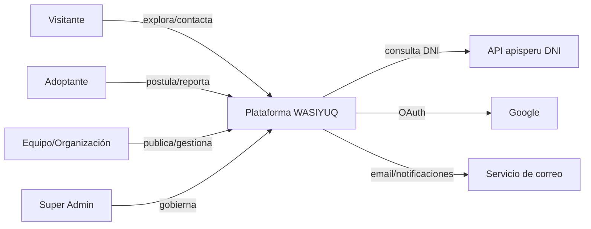

# Modelo de negocio

**Fecha:** 2026-11-16  
**Fuentes:** `README.md`, rutas/controladores/modelos/servicios, `docs/business/BUSINESS_OVERVIEW.md`, `docs/business/WORKFLOWS.md`.  
**Clasificación:** mezcla de elementos **verificados** en código y **inferidos** (marcados) sobre propuesta de valor/operación.

## 1. Propuesta de valor

| Segmento | Necesidad | Valor entregado por WASIYUQ (evidencia) | Estado |
|---|---|---|---|
| Ciudadanos/adoptantes | Encontrar y adoptar mascotas responsablemente | Catálogo público, postulación con screening, seguimiento post-adopción, directorios (veterinarias/albergues), contenido educativo/comunitario | Verificado (funcional) |
| Organizaciones/albergues (equipos) | Publicar mascotas y gestionar procesos de adopción | Panel por equipo, gestión de mascotas/adopciones/seguimientos, blog/eventos, perfil y miembros | Verificado |
| Comunidad | Visibilizar eventos, mascotas perdidas, información | Eventos, blog, reporte/listado de mascotas perdidas, contacto, chatbot | Verificado |
| Plataforma/administración | Gobernanza y control | Super admin de usuarios, organizaciones y contenido global | Verificado |

## 2. Actores y relaciones (ecosistema)

## 3. Modelo operativo

- **Adquisición/descubrimiento:** sitio público (SEO básico vía sitemap, contenido blog/eventos). *Inferido: sin evidencia de campañas/monetización en código.*
- **Onboarding:**
  - Adoptantes/usuarios: registro Fortify y/o Google OAuth.
  - Organizaciones: modeladas como `Team` organizacional con miembros/roles; alta y verificación operativa **inferida/pendiente** (existen CRUD admin y solicitudes de contacto “Registrar entidad” en chatbot, pero flujo formal de alta no plenamente trazado).
- **Operación núcleo:** publicación de mascotas → postulación → evaluación (aprobar/rechazar) → (completar, pendiente confirmar disparo) → plan de seguimiento y control de hitos.
- **Soporte/comunidad:** eventos, blog, mascotas perdidas, directorios y calificaciones de veterinarias/albergues, contacto y chatbot por reglas.
- **Gobernanza:** panel `/admin` restringido a super admin.

## 4. Modelo de ingresos y costos

| Elemento | Observación | Estado |
|---|---|---|
| Ingresos | **No se identifica lógica de cobro, suscripciones, comisiones ni pasarelas de pago** en rutas, modelos o servicios revisados. Chatbot afirma adopción gratuita. | Verificado (ausencia en código inspeccionado) |
| Costos operativos (implícitos) | Hosting/app, BD (SQL Server objetivo), almacenamiento de archivos, correo transaccional, API DNI externa, dominios/servicios (GA, OAuth) | Inferido |
| Monetización futura | No definida en repositorio | Pendiente de confirmación |

> **Conclusión:** el modelo observado es de **plataforma de servicio/social sin monetización implementada**; cualquier esquema comercial es **pendiente de decisión de negocio**.

## 5. Recursos y capacidades clave

- **Tecnológicos:** monolito Laravel + Inertia/Vue, BD relacional, storage de imágenes/PDFs, colas/notificaciones, integraciones (Google, DNI, correo), PWA/Capacitor.
- **Datos/activos:** catálogo de mascotas, perfiles de equipos, historial de adopciones y seguimientos, contenido (blog/eventos), directorios.
- **Procesos:** screening de adopción, seguimiento programado (hitos automáticos al completar), verificación administrativa (parcialmente inferida).

## 6. Indicadores observables en producto (proxies)

- Métricas de dashboard de equipo: conteos de mascotas/adopciones/anuncios/blog/seguimientos y recientes (`routes/web.php` dashboard team). **Verificado.**
- Estados de adopción/seguimiento/mascota para embudo operativo. **Verificado.**
- Analítica web configurable (GA4). **Parcial (config presente).**

## 7. Riesgos y supuestos de negocio

| Riesgo/Supuesto | Impacto | Estado |
|---|---|---|
| Flujo “completar adopción” no confirmado en UI | Plan de seguimiento automático podría no activarse | Pendiente de confirmación |
| Dependencia de correo/colas/scheduler para notificaciones y vencimientos | Degradación operativa si no corren | Verificado (diseño) |
| Ausencia de monetización implementada | Sostenibilidad depende de decisiones externas | Verificado (ausencia) |
| Confianza/seguridad (bypass superadmin hardcodeado) | Riesgo reputacional y de acceso | Verificado |