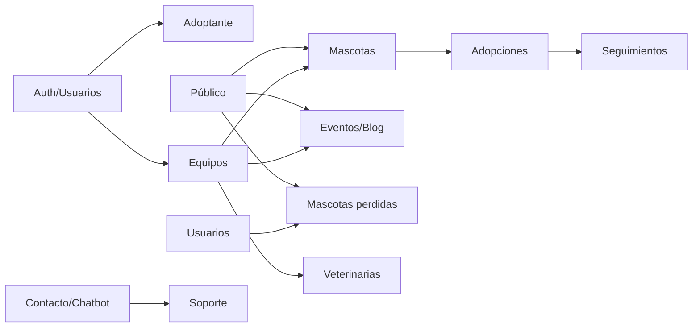

# Catálogo de módulos

**Fecha:** 2026-11-16  
**Fuente:** rutas (`routes/*.php`), controladores (`app/Http/Controllers/**`), modelos, servicios, páginas Inertia (`resources/js/pages/**`).

> Se documentan módulos detectados en la implementación. El nivel de detalle interno por acción se amplía en documentos funcionales/técnicos específicos.

## Resumen de módulos

| Módulo | Propósito | Actores principales | Áreas UI/API | Entidades principales |
|---|---|---|---|---|
| Sitio público y descubrimiento | Mostrar contenido e información institucional | Visitante | `/`, `/mascotas`, `/eventos`, `/blog`, `/sobre-nosotros`, `/contacto`, sitemap | `Pet`, `Announcement`, `BlogPost`, `Team`, `ContactRequest` |
| Mascotas (adopción) | Catálogo y gestión de mascotas | Visitante, adoptante, equipo, admin | Público, `/mi-adopcion/mascotas`, `/{team}/mascotas`, `/admin/mascotas` | `Pet`, `Team` |
| Adopciones | Postulación, evaluación y resolución | Adoptante, equipo, admin | `/mascotas/{slug}/postular`, `/mi-adopcion/postulaciones`, `/{team}/adopciones`, `/admin/adopciones` | `Adoption`, `Pet`, `User`, `Team` |
| Seguimientos post-adopción | Planificación y reporte de bienestar | Adoptante, equipo, admin | `/mi-adopcion/seguimientos`, `/{team}/seguimientos`, `/admin/seguimiento` | `FollowUp`, `Adoption` |
| Eventos/Anuncios | Difusión de actividades y campañas | Visitante, equipo, admin | `/eventos`, `/{team}/eventos`, `/admin/eventos` | `Announcement`, `Team`, `User` |
| Blog | Contenido educativo/informativo | Visitante, equipo, admin | `/blog`, `/{team}/blog`, `/admin/blog` | `BlogPost`, `Team`, `User` |
| Mascotas perdidas | Reporte y gestión de extravíos/hallazgos | Visitante, adoptante | `/mascotas-perdidas`, `/mi-adopcion/mascotas-perdidas` | `LostPet`, `User`, `Team` |
| Organizaciones/Equipos | Gestión de albergues/entidades y membresías | Miembro equipo, admin, usuario | `/{team}/perfil`, `/{team}/miembros`, settings teams, `/admin/organizaciones`, `/admin/albergues` | `Team`, `Membership`, `TeamInvitation`, `TeamRating` |
| Veterinarias | Directorio, vinculación y reputación | Adoptante, equipo, admin, visitante autenticado | `/mi-adopcion/veterinarias`, `/{team}/veterinarias`, `/admin/veterinarias` | `Veterinarian`, `VeterinarianRating` |
| Usuarios y roles (admin) | Administración de cuentas, roles y membresías | Super admin | `/admin/usuarios`, `/admin/roles`, `/admin/perfil` | `User`, `Membership`, `Team`, `TeamRole` |
| Autenticación y seguridad de cuenta | Acceso, 2FA, passkeys, OAuth, perfil | Usuario | `/login`, `/register`, `/settings/*`, `/auth/google*` | `User`, `passkeys` |
| Contacto y soporte | Mensajería y asistencia automatizada | Visitante, admin (lectura implícita) | `/contacto`, `POST /api/chatbot/ask` | `ContactRequest` |
| Integraciones utilitarias | Consulta de datos externos | Usuario/app | `POST /api/dni/lookup` | (servicio externo) |

## Detalle por módulo (síntesis)

### 1. Sitio público y descubrimiento
- **Funciones:** home, listado/detalle de mascotas, eventos, blog, sobre nosotros, contacto, sitemap XML, health check.
- **Evidencia:** `routes/public.php`, `app/Http/Controllers/Public/*`, `resources/js/pages/Public/*`.
- **Notas:** SEO/meta/JSON-LD y PWA configurados en frontend/layout y Vite.

### 2. Mascotas (adopción)
- **Funciones:** búsqueda/filtrado público, detalle, CRUD por equipo y admin, publicación por adoptante en área personal, estados (`available`, `in_process`, `adopted`, `withheld`).
- **Reglas observadas:** creación de adopción cambia mascota a `in_process`; aprobación marca `adopted`; rechazo/cancelación vuelve a `available` (`AdoptionService`).
- **Entidades/campos:** especie, raza, edad, género, tamaño, color, descripción, notas médicas, fotos (JSON), slug.

### 3. Adopciones
- **Funciones:** postular (con screening: motivación, vivienda, experiencia, niños, otras mascotas, horas solo, plan veterinario, acuerdo), listar/ver, aprobar/rechazar (equipo), consulta admin.
- **Estados:** `pending`, `approved`, `rejected`, `completed`, `cancelled` (`AdoptionStatus`).
- **Automatizaciones:** dispatch de eventos `AdoptionApplicationSubmitted`, `AdoptionApproved`, `AdoptionCompleted`; listeners/jobs relacionados existen (p.ej. plan de seguimiento, notificaciones, acta/certificado) — ejecución efectiva por flujo a verificar.

### 4. Seguimientos post-adopción
- **Funciones:** listado por adoptante/equipo/admin, detalle, reporte de hito con notas/fotos y campos de salud/seguimiento, completar/no realizado, programar adicional, detección de atrasados (`checkOverdue`).
- **Estados:** `pending`, `completed`, `missed` (`FollowUpStatus`).

### 5. Eventos/Anuncios
- **Funciones:** CRUD y publicación por equipo/admin, visualización pública por listado/slug.
- **Tipos:** `adoption_fair`, `fundraiser`, `workshop`, `campaign`, `other` (`AnnouncementType`).

### 6. Blog
- **Funciones:** CRUD y publicación por equipo/admin, visualización pública, categorías/tags/excerpt/contenido.
- **Evidencia adicional:** dependencia `marked` sugiere render Markdown en frontend (confirmar uso).

### 7. Mascotas perdidas
- **Funciones:** reporte público (formulario con foto/url, datos y contacto), listado/detalle público, gestión por adoptante (editar/actualizar/eliminar), estados perdido/encontrado y resolución (según modelo/campos).

### 8. Organizaciones/Equipos
- **Funciones:** equipos personales y organizacionales, perfiles enriquecidos (bio, contacto, redes, mapa, galería, soporte), miembros, invitaciones, calificaciones de equipo/albergue, panel por slug.

### 9. Veterinarias
- **Funciones:** directorio con ficha, servicios/fotos/geo, creación desde adoptante/equipo, calificación, verificación por admin, eliminación admin.

### 10. Usuarios y roles (admin)
- **Funciones:** CRUD usuarios, asignación de rol/super admin (según UI/controlador), gestión de membresías por equipo, consulta de roles.

### 11. Autenticación y seguridad de cuenta
- **Funciones:** Fortify (login/registro/reset/verificación), 2FA, passkeys (deps/componentes/composables), Google Socialite, perfil/seguridad/apariencia.

### 12. Contacto y soporte
- **Funciones:** formulario de contacto persistido en `contact_requests`, plantilla email `contact-message`, chatbot basado en reglas con respuestas predefinidas.

### 13. Integraciones utilitarias
- **DNI:** lookup vía `apisperu.com` (`DniLookupService`), endpoint `/api/dni/lookup`, manejo de token ausente/no encontrado/error.
- **Analítica:** `GA_MEASUREMENT_ID` configurado (uso real en frontend por verificar).

## Dependencias entre módulos (alto nivel)

