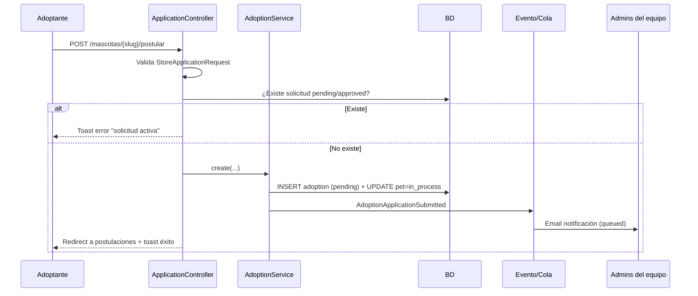
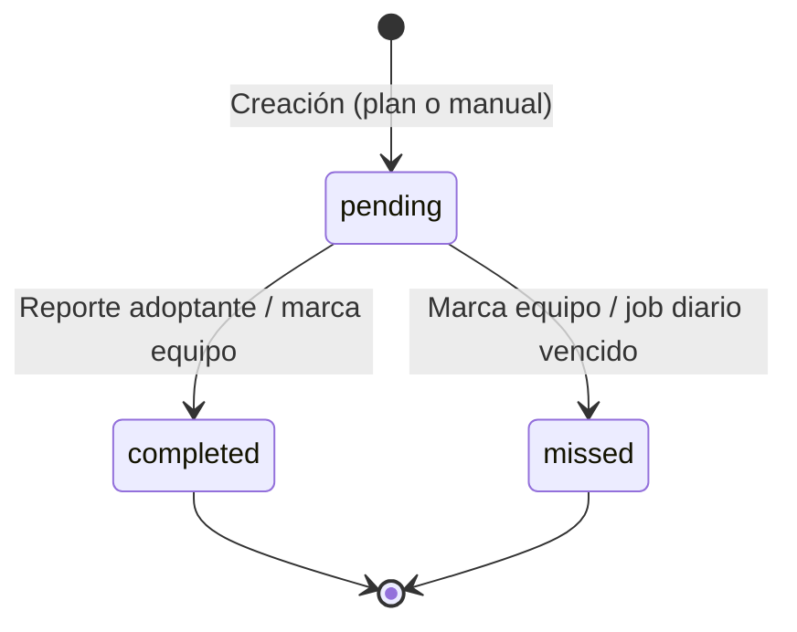

# Flujos operativos (Workflows)

**Fecha:** 2026-11-16  
**Alcance:** flujos end-to-end inferidos desde rutas, controladores, servicios, eventos/listeners/jobs, requests y notificaciones.  
**Evidencia principal:** `routes/public.php`, `routes/web.php`, `routes/admin.php`, `app/Services/AdoptionService.php`, `app/Services/FollowUpService.php`, `app/Listeners/*`, `app/Jobs/*`, `app/Http/Controllers/**`.

> Clasificación: **Verificado** cuando hay evidencia directa de código; **Inferido** cuando depende de UI/operación no leída en detalle; **Pendiente de confirmación** cuando requiere ejecución/entorno.

## 1. Descubrimiento público de mascotas y contenido

| Paso | Actor | Acción | Resultado | Evidencia | Estado |
|---|---|---|---|---|---|
| 1 | Visitante | Accede a home `/` | Se renderiza landing | `routes/public.php` → `HomeController@index` | Verificado |
| 2 | Visitante | Explora catálogo `/mascotas` y detalle `/mascotas/{slug}` | Consulta mascotas públicas | `Public\PetController@index,show` | Verificado |
| 3 | Visitante | Explora eventos/blog/mascotas perdidas/sobre nosotros/contacto | Contenido informativo y comunitario | `routes/public.php` | Verificado |
| 4 | Visitante | Envía contacto `POST /contacto` | Se registra solicitud y se envía correo | `ContactController` (ruta), `app/Mail/ContactMessage.php`, `ContactRequest` (modelo) | Verificado (plantilla/vista de correo pendiente detalle) |

## 2. Registro, autenticación y acceso

| Paso | Actor | Acción | Resultado | Evidencia | Estado |
|---|---|---|---|---|---|
| 1 | Usuario | Registro/login/password/2FA | Sesión autenticada vía Fortify | `config/fortify.php` implícito en stack, rutas/settings, dependencias | Inferido/Parcial |
| 2 | Usuario | Login con Google `/auth/google` → callback | Autenticación OAuth y vinculación/alta según implementación | `routes/web.php`, `SocialLoginController`, `config/services.php` (`google`) | Verificado (reglas exactas de alta/vinculación por leer) |
| 3 | Usuario autenticado | Accede a `/dashboard` | Redirección: sin equipo→`/mi-adopcion`, personal→`/mi-adopcion`, org→`/{slug}/dashboard` | `routes/web.php` closure `dashboard` | Verificado |
| 4 | Miembro | Accede a rutas `/{current_team}/*` | Middleware valida existencia/equipo no personal; superadmin bypass por flag/email | `EnsureTeamMembership` | Verificado |
| 5 | Super admin | Accede a `/admin/*` | Middleware `IsSuperAdmin` (flag o email hardcodeado) | `IsSuperAdmin` | Verificado |

## 3. Postulación de adopción (adoptante)

| Paso | Actor | Acción | Resultado | Evidencia | Estado |
|---|---|---|---|---|---|
| 1 | Adoptante autenticado | Envía `POST /mascotas/{slug}/postular` con datos de screening | Valida request; rechaza si ya hay solicitud `pending/approved` para misma mascota/usuario | `Adopter\ApplicationController@store`, `StoreApplicationRequest` | Verificado |
| 2 | Sistema | Crea adopción en transacción | Registro `adoptions` con estado `pending` y datos del formulario | `AdoptionService::create` | Verificado |
| 3 | Sistema | Actualiza mascota | `pets.status = in_process` | `AdoptionService::create` | Verificado |
| 4 | Sistema | Dispara evento `AdoptionApplicationSubmitted` | Listener en cola notifica por mail a miembros con rol ≥ Admin del equipo | `AppServiceProvider`, `NotifyEntityOfNewApplication`, `AdoptionApplicationSubmittedNotification` | Verificado |
| 5 | Adoptante | Consulta `GET /mi-adopcion/postulaciones` | Lista sus postulaciones | `Adopter\ApplicationController@index` | Verificado |

## 4. Revisión de adopción por organización/equipo

| Paso | Actor | Acción | Resultado | Evidencia | Estado |
|---|---|---|---|---|---|
| 1 | Miembro equipo | Lista/ver adopciones del team | Ve postulaciones y detalle | `Dashboard\AdoptionController@index,show` | Verificado |
| 2a | Miembro equipo | Aprueba adopción | `adoptions.status=approved`, `reviewed_by/at`, `pets.status=adopted`, evento `AdoptionApproved` | `Dashboard\AdoptionController@approve`, `AdoptionService::approve` | Verificado |
| 2b | Miembro equipo | Rechaza adopción con nota opcional | `adoptions.status=rejected`, nota, `pets.status=available` | `Dashboard\AdoptionController@reject`, `AdoptionService::reject` | Verificado |
| 3 | Sistema (tras aprobar) | Listener notifica adoptante y genera acta | Email al adoptante + `GenerateAdoptionActaJob` (PDF a `public`, guarda `acta_path`) | `NotifyAdopterOfApproval`, `AdoptionApprovedNotification`, `GenerateAdoptionActaJob` | Verificado |
| 4 | Sistema/operación | Completar adopción | `adoptions.status=completed` + evento `AdoptionCompleted` | `AdoptionService::complete` (invocación UI/endpoint específica no confirmada en rutas dashboard leídas) | **Pendiente de confirmación** |
| 5 | Sistema (tras completar) | Crea plan de seguimiento | 5 hitos `pending` a 30/90/180/270/365 días | `CreateFollowUpPlan` | Verificado (condicionado a disparo de `complete`) |
| 6 | Cancelación | Cancelar adopción | `adoptions.status=cancelled`, `pets.status=available` | `AdoptionService::cancel` (invocación no confirmada) | Pendiente de confirmación |

## 5. Seguimiento post-adopción (adoptante y equipo)

| Paso | Actor | Acción | Resultado | Evidencia | Estado |
|---|---|---|---|---|---|
| 1 | Adoptante | Lista/ver seguimientos propios | Solo seguimientos de sus adopciones | `Adopter\FollowUpReportController@index,show` | Verificado |
| 2 | Adoptante | Reporta hito `pending` con notas/fotos | Valida imágenes (max 5MB c/u), guarda en `follow-ups` (disk public), estado `completed`, `completed_date=now` | `Adopter\FollowUpReportController@report`, `FollowUpService::reportMilestone` | Verificado |
| 3 | Miembro equipo | Lista/ver seguimientos del equipo, filtra por estado | Consulta por `team_id` de adopción | `Dashboard\FollowUpController@index,show`, `FollowUpService::getByTeam` | Verificado |
| 4 | Miembro equipo | Marca completado / no realizado | `completed` + fecha o `missed` | `Dashboard\FollowUpController@markCompleted,@markMissed` | Verificado |
| 5 | Miembro equipo | Programa seguimiento adicional | Crea `FollowUp` `pending` para adopción, fecha > hoy | `Dashboard\FollowUpController@schedule`, `FollowUpService::scheduleAdditional` | Verificado |
| 6 | Scheduler (diario) | Ejecuta `CheckOverdueMilestonesJob` | Marca `pending` con fecha pasada como `missed` (update masivo) | `routes/console.php`, `CheckOverdueMilestonesJob`, `FollowUpService::checkOverdue` | Verificado (requiere worker/scheduler activo) |

## 6. Gestión de mascotas, contenido y perfil de equipo

| Flujo | Actor | Resumen | Evidencia | Estado |
|---|---|---|---|---|
| Mascotas de equipo | Miembro equipo | CRUD en `/{team}/mascotas*`; subida de fotos a storage público; estados y slugs | `Teams\PetController`, `Store/UpdatePetRequest`, búsquedas storage `pets/` | Verificado |
| Mascotas de adoptante (propias) | Adoptante | Crear/listar/eliminar en `/mi-adopcion/mascotas*` | `Adopter\PetController` | Verificado (reglas detalle por leer) |
| Blog/Eventos equipo | Miembro equipo | CRUD blog y eventos/anuncios del equipo | `Dashboard\BlogPostController`, `Dashboard\EventController`, requests blog/announcement | Verificado |
| Perfil equipo | Miembro equipo | Edita datos, logo/galería (`teams/logos`, `teams/gallery`) | `Teams\TeamProfileController` | Verificado |
| Veterinarias del equipo | Miembro equipo | Gestión vinculada al equipo | `Teams\VeterinarianController` | Parcial |
| Mascotas perdidas | Público/Adoptante | Reporte público y gestión propia; fotos `lost-pets/` | `Public\LostPetController`, `Adopter\LostPetController` | Verificado |

## 7. Administración global

| Flujo | Actor | Resumen | Evidencia | Estado |
|---|---|---|---|---|
| Gestión entidades | Super admin | Usuarios/roles/membresías, organizaciones, mascotas, eventos, blog, adopciones, seguimientos, veterinarias, albergues | `routes/admin.php`, `App\Http\Controllers\Admin\*` | Verificado (alcance/validaciones finas parciales) |
| Verificación veterinarias | Super admin | Acciones de verificación/listado | `Admin\VeterinarianController` | Parcial |

## 8. Integraciones y utilidades

| Flujo | Actor | Resumen | Evidencia | Estado |
|---|---|---|---|---|
| Chatbot | Visitante/app | `POST /api/chatbot/ask`, respuesta por reglas en memoria (sin IA externa), botones sugeridos | `Public\ChatbotController`, `ChatbotService` | Verificado |
| Consulta DNI | Autenticado/contexto | `POST /api/dni/lookup` consume API externa con token; maneja faltante/no encontrado/error | `Api\DniController`, `DniLookupService`, `config/services.php` | Verificado |
| Contacto | Visitante | `POST /contacto` envía `ContactMessage` (Mailable, reply-to usuario) | `routes/public.php`, `ContactMessage` | Verificado (persistencia/vista exacta parcial) |

## Hallazgos relevantes
- **Sin invocación en runtime de SPs:** se definen 9 procedimientos T-SQL en `database/stored-procedures/**` y comando de carga, pero no se hallaron llamadas `DB::statement/select/exec` a `sp_*` en `app/` (búsqueda estática). Uso real **pendiente de confirmación**.
- **Dos jobs de PDF escriben `acta_path`:** `GenerateAdoptionActaJob` (disparado al aprobar) y `GenerateAdoptionCertificateJob` (no se halló disparador). Riesgo de sobrescritura/ambigüedad.
- **Completar/cancelar adopción:** lógica de servicio existe, pero disparo desde UI/ruta no confirmado en evidencia leída; afecta activación del plan de seguimiento.
- **Scheduler/colas:** requiere `schedule:run` y worker de colas para listeners/jobs/notificaciones asíncronas; `.env.example` por defecto usa `sync` en entornos simples (a validar).