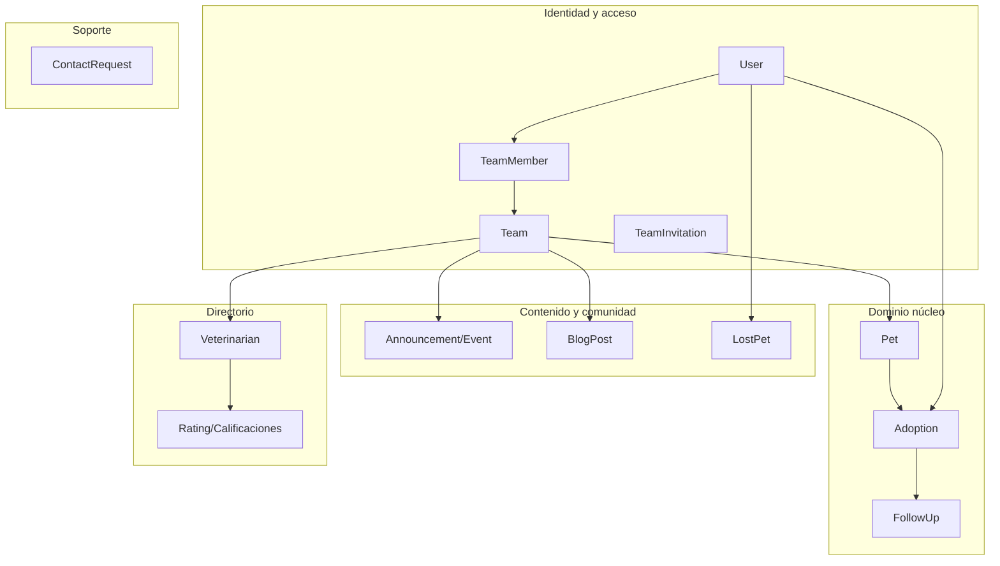

# Modelo de dominio

**Fecha:** 2026-11-16  
**Fuentes:** `app/Models/*`, `app/Enums/*`, migraciones (referenciadas en `docs/technical/DATABASE_SCHEMA.md`), servicios, `docs/domain/ENTITY_CATALOG.md`.

## 1. Visión general

El dominio se organiza alrededor de **equipos (tenancy)** que publican **mascotas** y gestionan **adopciones** con **seguimientos** post-adopción. Se complementa con dominios de **contenido/comunidad** (eventos/anuncios, blog, mascotas perdidas), **directorio** (veterinarias, albergues/calificaciones) y **soporte** (contacto).

## 2. Bounded contexts (lógico, sobre monolito actual)

## 3. Agregados y relaciones clave

| Agregado/raíz | Entidades relacionadas | Reglas/invariantes observadas | Evidencia | Estado |
|---|---|---|---|---|
| **Team** | Users (membresías/roles), Pets, Adoptions (vía pet/team), Announcements, BlogPosts, Veterinarians | Slug único lógico para rutas; `is_personal` altera acceso a dashboard; permisos por `TeamPermission` vía policy/usuario | `Team`, `TeamPolicy`, `EnsureTeamMembership` | Verificado |
| **Pet** | Team (dueño/organización), Adoptions, (fotos) | Estados `available/in_process/adopted/withheld`; creación de adopción fuerza `in_process`; approve→`adopted`; reject/cancel→`available`; soft delete | `Pet`, `PetStatus`, `AdoptionService` | Verificado |
| **Adoption** | Pet, Adopter(User), Team, Reviewer(User), FollowUps, `acta_path` | Estados `pending/approved/rejected/completed/cancelled`; transiciones con side-effects (pet, eventos, reviewer/fechas); datos de screening obligatorios al postular | `Adoption`, `AdoptionService`, `StoreApplicationRequest` | Verificado |
| **FollowUp** | Adoption, Creator(User) | Estados `pending/completed/missed`; plan automático 5 hitos al completar adopción; reporte con fotos/notas; vencidos→`missed` por job | `FollowUp`, `FollowUpService`, `CreateFollowUpPlan`, `CheckOverdueMilestonesJob` | Verificado (activación completa dependiente de `complete`) |
| **User** | Teams, Adoptions, FollowUps creados, LostPets, contenido | Identidad/auth; puede ser super admin; adopciones propias | `User`, middlewares, controladores | Verificado |
| **Content (Announcement/BlogPost)** | Team, Author(User) | Publicación/slugs/categorías o tipos; listados públicos | modelos/controladores | Parcial |
| **LostPet** | User/reportante, ubicación/fotos/contacto | Reporte público y gestión autenticada | `LostPet` rutas/controladores | Parcial |
| **Directory (Veterinarian/Rating)** | Team (opcional), calificaciones de usuarios | Alta/listado/verificación (admin) y calificación | controladores admin/public/adoptante | Parcial |

## 4. Invariantes y reglas de transición (resumen)

- Una mascota solo debería tener flujo de adopción coherente con su estado (ej. postular crea adopción y pasa a `in_process`). **Verificado** en `AdoptionService::create`.
- Aprobar: requiere reviewer; cambia mascota a `adopted` y notifica/genera acta. **Verificado.**
- Rechazar/Cancelar: libera mascota a `available`. **Verificado.**
- Completar: dispara creación de 5 seguimientos programados. **Verificado (evento/listener)**, disparo operativo **pendiente**.
- No se permite postulación duplicada activa (`pending|approved`) para mismo usuario/mascota. **Verificado** en `ApplicationController@store`.
- Acceso a rutas de equipo exige pertenencia y, para dashboard org, equipo no personal (salvo superadmin bypass). **Verificado.**

## 5. Eventos de dominio (implementados)

| Evento | Disparador | Efectos | Evidencia |
|---|---|---|---|
| `AdoptionApplicationSubmitted` | `AdoptionService::create` | Email a miembros Admin+ del equipo (queued) | `NotifyEntityOfNewApplication` |
| `AdoptionApproved` | `AdoptionService::approve` | Email al adoptante + dispatch `GenerateAdoptionActaJob` (queued) | `NotifyAdopterOfApproval` |
| `AdoptionCompleted` | `AdoptionService::complete` | Crea 5 `FollowUp` pendientes (queued listener) | `CreateFollowUpPlan` |

## 6. Desajustes y puntos a validar

- **SPs definidos pero no invocados** en código app: posible lógica de lectura alternativa/legacy. 
- **Doble job PDF sobre `acta_path`** (`Acta` vs `Certificate`): semántica de documento no unificada.
- **`FollowUpService::checkOverdue`** (usado por job) marca como `missed`, mientras `getOverdue()` solo consulta: comportamiento correcto pero naming a confirmar. 
- **Campos de seguimiento:** `Store/UpdateFollowUpRequest` aceptan URLs en `photos.*` y metadatos (peso, vacunas, salud) que no se persisten en `reportMilestone`/`scheduleAdditional` actuales (solo notas/fotos subidas/estado/fechas). **Brecha verificada por comparación request vs servicio.**