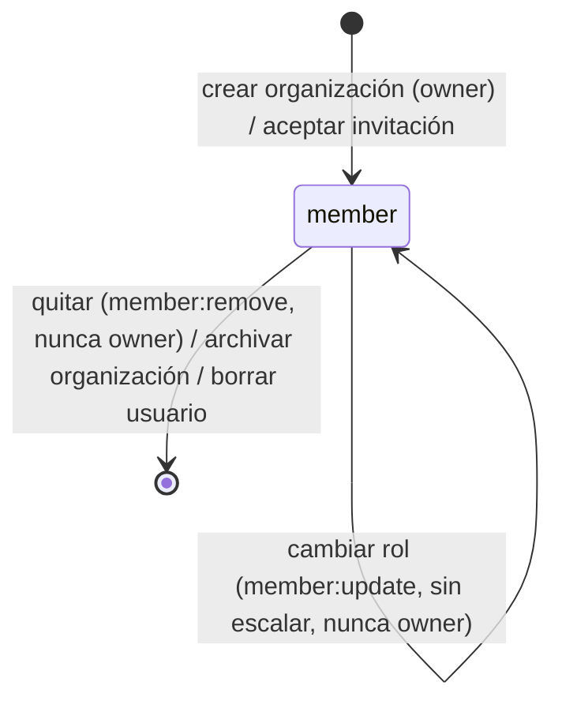
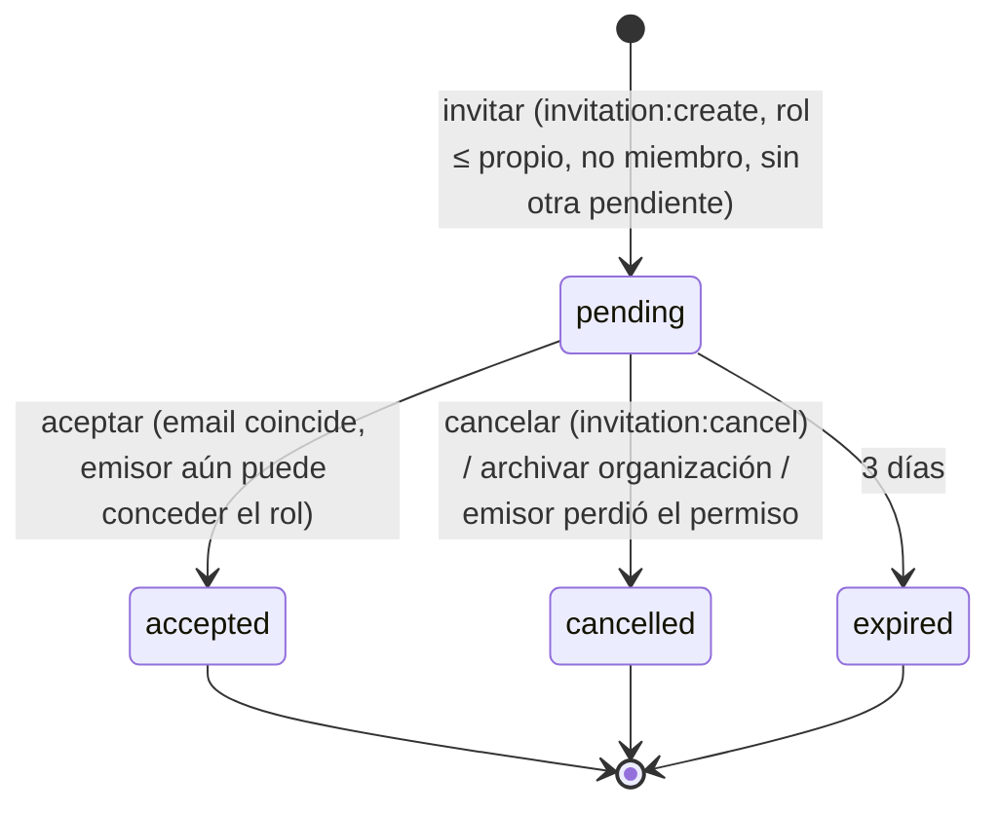

# Ciclo de vida de organizaciones y membresías — WASIYUQ 2.0 (Fase 3)

**Fecha:** 2026-11-17  
**Implementación:** `modules/organizations` (dominio, casos de uso, repositorio Drizzle). **Legacy de referencia:** `Team`, `Membership`, `TeamInvitation`, `CreateTeam`, `TeamController`, `TeamMemberController`, `TeamInvitationController` (historial git `8b77756^`).

## 1. Conceptos

| Concepto 2.0 | Legacy | Significado |
|---|---|---|
| Organización `kind=organization` | `Team` con `is_personal=false` | Albergue/equipo que opera la plataforma |
| Organización `kind=personal` | `Team` con `is_personal=true` | Contexto privado del usuario (área adoptante); una por usuario |
| Membresía | `team_members` | Usuario ↔ organización con **un** rol; un usuario puede pertenecer a muchas organizaciones |
| Propietario | rol `owner` | Exactamente uno por organización (índice único parcial) |
| Contexto activo | `users.current_team_id` | Organización en la que el usuario trabaja (`organization_contexts`) |
| Invitación | `team_invitations` | Oferta de membresía con rol, ligada a un email, caduca a los 3 días |

## 2. Organización

```mermaid
stateDiagram-v2
  [*] --> active: crear (creador = owner, pasa a contexto activo)
  active --> active: actualizar perfil (team:update; renombrar regenera slug)
  active --> archived: eliminar (team:delete + nombre exacto; no personal)
  archived --> [*]
```

- **Personal:** se crea automáticamente al registrarse (email u OAuth) y se re-asegura en cada `GET /api/v1/me` (idempotente). No admite miembros, invitaciones ni eliminación.
- **Slug:** derivado del nombre, único incluso entre archivadas, sufijo numérico en colisión (`patitas`, `patitas-1`…), palabras reservadas de rutas rechazadas. Renombrar regenera el slug (comportamiento legacy; ver decisiones pendientes).
- **Archivar** (equivale al soft delete legacy): marca `archived_at`, elimina membresías, cancela invitaciones pendientes y limpia contextos que apuntaban a ella. La fila se conserva (retención) y su slug queda reservado. No existe borrado físico desde la aplicación.

## 3. Membresía

Reglas (`domain/policy.ts`): no se gestiona al propietario, a miembros de nivel superior ni la propia membresía; solo se asignan roles de nivel ≤ al propio. Al quitar a un miembro se limpia su contexto si apuntaba a esa organización; su acceso termina en la siguiente petición (la autorización se evalúa siempre contra la BD).

## 4. Invitación

- **Token:** 32 bytes aleatorios (base64url). Solo se guarda su SHA-256; el token viaja únicamente en el correo (`/invitations/<token>`). La API nunca lo devuelve y los logs lo redactan.
- **Vista previa:** requiere sesión; muestra organización, rol, estado y si el email coincide, sin revelar el email invitado.
- **Aceptación:** en una transacción con bloqueo de la invitación; si el usuario ya era miembro conserva su rol (legacy `firstOrCreate`); el contexto activo pasa a la organización.
- Una invitación caducada o cancelada no bloquea una nueva al mismo email.

## 5. Contexto activo

`GET /api/v1/me` devuelve membresías y `activeOrganizationId`. Si el contexto guardado ya no es válido (membresía eliminada, organización archivada), se usa la organización personal. Cambiar de contexto (`POST /organizations/:id/switch`) exige membresía.

## 6. Retención y borrado

| Evento | Efecto |
|---|---|
| Archivar organización | Fila conservada; membresías eliminadas; invitaciones pendientes canceladas |
| Borrar usuario (no expuesto en la API) | Cascada: sesiones, cuentas, membresías, contexto y su organización personal; las invitaciones que emitió conservan la fila con `invited_by = NULL` |
| Tablas de negocio futuras | Deben referenciar `organizations` con `ON DELETE RESTRICT` |

## 7. Decisiones pendientes

1. ¿Debe mantenerse la regeneración del slug al renombrar (rompe URLs públicas)?
2. Transferencia de propiedad y "abandonar organización" (inexistentes en legacy).
3. Visibilidad de emails de miembros para todos los miembros (legacy: sí; se mantiene).
4. Alta/verificación formal de organizaciones por la plataforma (legacy: no trazado).
