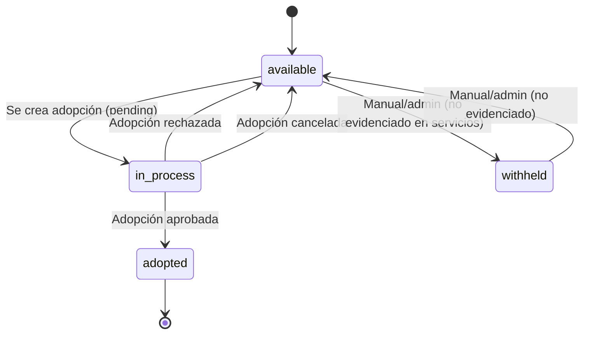
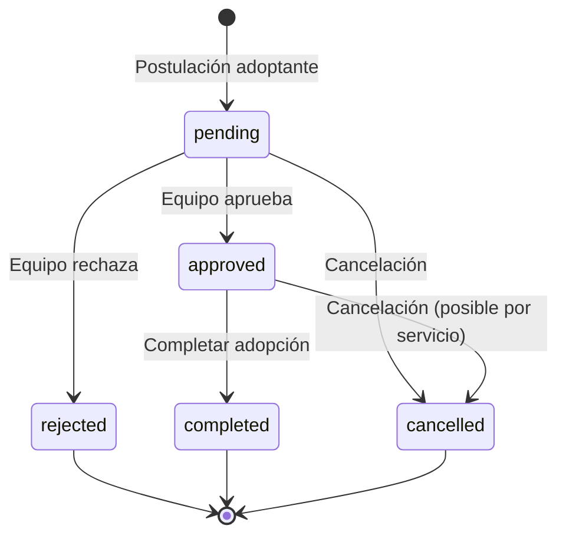
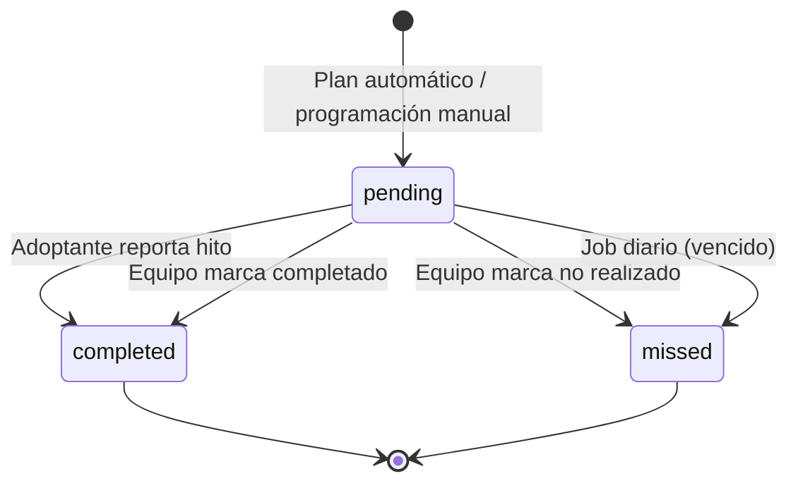

# Máquinas de estado

**Fecha:** 2026-11-16  
**Fuentes:** `app/Services/AdoptionService.php`, `app/Services/FollowUpService.php`, `app/Enums/PetStatus.php`, `app/Enums/FollowUpStatus.php`, `app/Listeners/CreateFollowUpPlan.php`, `routes/console.php`, `app/Http/Controllers/**`.

## 1. Mascota (`Pet.status`)

**Estados:** `available`, `in_process`, `adopted`, `withheld` (enum; `withheld` observado en enum/request, transiciones automáticas no evidenciadas).  
**Estado inicial típico:** `available` (al publicar, según requests de creación). **Verificado**.

| Transición | Disparador | Efectos | Evidencia | Estado |
|---|---|---|---|---|
| available → in_process | `AdoptionService::create` | Crea adopción `pending`, evento `AdoptionApplicationSubmitted` | `AdoptionService` | Verificado |
| in_process → adopted | `AdoptionService::approve` | Adopción `approved`, reviewer/fecha, evento `AdoptionApproved` | `AdoptionService` | Verificado |
| in_process → available | `AdoptionService::reject` | Adopción `rejected`, notas/reviewer/fecha | `AdoptionService` | Verificado |
| in_process → available | `AdoptionService::cancel` | Adopción `cancelled` | `AdoptionService` | Verificado (invocación UI pendiente) |
| ↔ withheld | Edición CRUD | Sin lógica de servicio específica vista | Requests/controllers Pet | Pendiente de confirmación |

## 2. Adopción (`Adoption.status`)

**Estados:** `pending`, `approved`, `rejected`, `completed`, `cancelled`.  
**Estado inicial:** `pending` al postular. **Verificado**.

| Transición | Guardas/validaciones observadas | Efectos secundarios | Evidencia | Estado |
|---|---|---|---|---|
| → pending | Auth; no solicitud activa previa (`pending/approved`) mismo user+pet; validación `StoreApplicationRequest` (motivación ≥150, campos obligatorios, acuerdo) | Pet `in_process`; evento submitted→notifica admins | `ApplicationController`, `AdoptionService` | Verificado |
| pending → approved | Miembro del team (ruta dashboard) | `reviewed_by/at`; pet `adopted`; evento approved→notifica adoptante + genera acta PDF | `Dashboard\AdoptionController@approve`, `AdoptionService` | Verificado |
| pending → rejected | Miembro del team | `reviewed_by/at`, `notes`; pet `available` | `Dashboard\AdoptionController@reject`, `AdoptionService` | Verificado |
| approved → completed | **No se halló ruta/acción UI específica** | Evento completed→crea 5 seguimientos | `AdoptionService::complete`, `CreateFollowUpPlan` | **Pendiente de confirmación** |
| * → cancelled | **No se halló ruta/acción UI específica** | Pet `available` | `AdoptionService::cancel` | Pendiente de confirmación |

## 3. Seguimiento (`FollowUp.status`)

**Estados:** `pending`, `completed`, `missed`.  
**Estado inicial:** `pending`. **Verificado**.

| Transición | Guardas/validaciones | Efectos | Evidencia | Estado |
|---|---|---|---|---|
| → pending (plan) | Evento `AdoptionCompleted` recibido | Crea 5 hitos (+30,+90,+180,+270,+365 días) con `notes` etiqueta y `created_by=reviewed_by` | `CreateFollowUpPlan` | Verificado |
| → pending (manual) | `adoption_id` existe, `scheduled_date` > hoy | Crea seguimiento con `created_by` usuario actual | `Dashboard\FollowUpController@schedule` | Verificado |
| pending → completed (adoptante) | Dueño de la adopción; seguimiento `pending` (422 si no); fotos imágenes ≤5MB | Guarda notas/fotos en `follow-ups` (public), `completed_date=now` | `FollowUpReportController@report`, `FollowUpService::reportMilestone` | Verificado |
| pending → completed (equipo) | Acceso dashboard team (autorización fina no detallada en controlador) | `completed_date=now` | `Dashboard\FollowUpController@markCompleted` | Verificado (authz fina parcial) |
| pending → missed (equipo) | Acceso dashboard team | `status=missed` | `Dashboard\FollowUpController@markMissed` | Verificado |
| pending → missed (sistema) | `scheduled_date < now` y `status=pending` | Update masivo diario por scheduler | `CheckOverdueMilestonesJob`, `FollowUpService::checkOverdue` | Verificado |

## 4. Otros estados relevantes (parcial)

| Entidad | Estados/campo | Notas | Estado |
|---|---|---|---|
| `Announcement` / `BlogPost` | `is_published`, `published_at` | Publicación/visibilidad pública | Parcial |
| `TeamInvitation` | Aceptada/cancelada/vigente | Flujo de invitación y aceptación por código | Parcial (controladores/requests existen) |
| `Veterinarian` | `is_verified` | Verificación por admin | Parcial |
| `LostPet` | Estados de reporte (abierto/encontrado etc.) | Definición exacta en modelo/enum a confirmar | Pendiente |

## 5. Estados implementados en 2.0 (Fase 3)

### 5.1 Cuenta de usuario (`users.status`)

```mermaid
stateDiagram-v2
  [*] --> active: registro (email/contraseña u OAuth)
  active --> suspended: admin de plataforma (no a sí mismo); revoca todas las sesiones
  suspended --> active: admin de plataforma
```

Verificación de email (`email_verified`) es ortogonal: `false` al registrarse con contraseña, `true` tras el enlace o con Google. Sin verificar se puede iniciar sesión, pero no usar funciones de organización.

### 5.2 Sesión

`creada` (sign-in/sign-up/verificación) → `expirada` (7 días sin renovar; renovación diaria) | `revocada` (sign-out, revocación desde perfil, restablecer contraseña, suspensión). Sin caché: el cambio es efectivo en la siguiente petición.

### 5.3 Organización, membresía e invitación

Ver diagramas en `docs/domain/ORGANIZATION_MEMBERSHIP.md`:
- Organización: `active` → `archived` (terminal, conserva fila y slug).
- Invitación: `pending` → `accepted` | `cancelled` | `expired` (precedencia accepted > cancelled > expired > pending).
