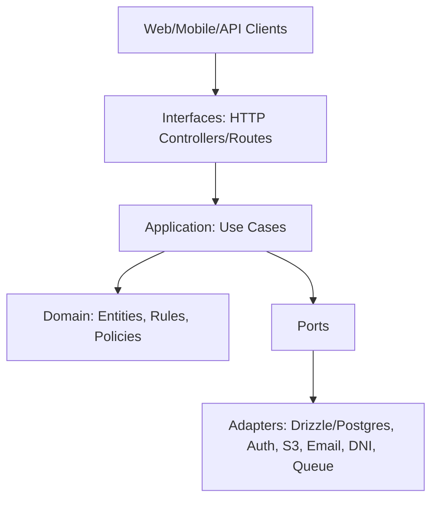

# Arquitectura objetivo

**Fecha:** 2026-11-16 (actualizado tras Fase 1)  
**Objetivo:** reconstruir WASIYUQ como plataforma moderna, mantenible y preparada para web y móvil, preservando dominio y reglas de negocio.

## Estado Fase 1 (fundación creada)
- Monorepo Bun/Turborepo/TypeScript inicializado con workspaces: `apps/{api,web,mobile}`, `modules/{identity,organizations,pets,adoptions,follow-ups,content,community,integrations}`, `packages/{core,db,auth,validation,api-client,ui,config}`, `infra/docker`, `docs/`.
- `apps/api`: Hono operativo con `GET /health`, logging JSON estructurado y prueba básica.
- `apps/web`: React + Vite + TanStack Router/Query + Tailwind scaffold operativo.
- `apps/mobile`: preparado (sin implementación funcional).
- Módulos y paquetes creados con límites/exports mínimos (`index.ts`); sin lógica de negocio implementada aún.

## 1. Principios

- **Modular Monolith primero:** desplegable único con límites internos claros; evolución a servicios solo con evidencia de necesidad.
- **Domain-centric:** reglas de negocio en el núcleo, independientes de framework/UI/transporte.
- **API-first y contratos tipados:** Zod/TypeScript como contrato compartido entre `api`, `web` y `mobile`.
- **Seguridad por defecto:** autorización centralizada, sin excepciones hardcodeadas, auditoría de acciones sensibles.
- **Trazabilidad:** cada capacidad mapeada al inventario funcional actual.

## 2. Estructura de monorepo (implementada en Fase 1 / propuesta de evolución)

```text
apps/
  api/          # Hono (scaffold + /health), casos de uso/HTTP/workers futuros
  web/          # React 19 + Vite + TanStack Router/Query + Tailwind
  mobile/       # React Native + Expo (preparado)
modules/
  identity/
  organizations/
  pets/
  adoptions/
  follow-ups/
  content/
  community/
  integrations/ # límites por bounded context (domain/app/infra/presentation a evolucionar)
packages/
  core/         # utilidades/dominio compartido base
  db/           # Drizzle/PostgreSQL (base preparada)
  auth/         # integración auth (pendiente evaluación Better Auth)
  validation/   # esquemas Zod compartidos
  api-client/   # cliente/contratos tipados (base)
  ui/           # componentes compartidos web (base)
  config/       # configuración compartida (base)
infra/
  docker/       # docker-compose PostgreSQL dev
docs/
```

> La separación fina `domain/application/infrastructure/presentation` dentro de cada módulo y la consolidación de `contracts/application` se completarán al implementar los módulos de negocio, manteniendo encapsulación vía `index.ts` y dependencias explícitas.

## 3. Bounded contexts propuestos

| Contexto | Responsabilidad | Entidades actuales relacionadas | Prioridad |
|---|---|---|---|
| Identity & Access | usuarios, sesiones, OAuth, 2FA/passkeys, roles plataforma | `User`, passkeys, 2FA | Muy alta |
| Organizations | equipos/orgs, perfiles, membresías, invitaciones, calificaciones | `Team`, `Membership`, `TeamInvitation`, `TeamRating` | Muy alta |
| Pets | catálogo y gestión de mascotas | `Pet` | Muy alta |
| Adoptions | postulaciones, evaluación, decisiones, documentos | `Adoption` | Muy alta |
| FollowUps | planificación y reportes post-adopción | `FollowUp` | Muy alta |
| Content | eventos/anuncios y blog | `Announcement`, `BlogPost` | Alta |
| Community | mascotas perdidas, contacto, directorios | `LostPet`, `ContactRequest`, `Veterinarian*` | Alta |
| Integrations | DNI, email, storage, analítica, chatbot | servicios externos | Media-Alta |

> Los límites deben validarse con el dominio real; `Veterinarian` puede pertenecer a Community o a un contexto Partner/Directory según evolución.

## 4. Capas por módulo (hexagonal/modular)



- **Domain:** invariantes y transiciones (p.ej. adopción creada → mascota en proceso; aprobación → adoptada).
- **Application:** orquesta casos de uso y transacciones.
- **Infrastructure:** implementaciones concretas (DB, proveedores externos).
- **Interfaces:** DTOs/validación de entrada/salida, mapeo a contratos.

## 5. Modelo de API y clientes

- **REST orientado a recursos** (o RPC tipado interno) con versionado (`/v1`) y contratos Zod compartidos.
- Respuestas y errores estandarizados; paginación/filtros consistentes.
- Autorización por **policy/permission checks** en capa de aplicación.
- SDK/cliente tipado compartido para web y móvil (aprovechando `contracts`).

## 6. Datos y migración

- **PostgreSQL** como fuente de verdad nueva; esquema diseñado desde dominio y mapeado a esquema actual.
- Estrategia de migración: extracción desde SQL Server, transformación (tipos, JSON, enums/strings, timestamps, soft deletes), carga verificable y reconciliación.
- Reemplazo de **stored procedures T-SQL** por consultas/repositorios/casos de uso en Drizzle, manteniendo resultados funcionales equivalentes.

## 7. Seguridad objetivo

- Autenticación robusta (sesiones seguras/JWT según diseño), OAuth Google, 2FA y passkeys si se confirma soporte.
- RBAC por permisos (equivalente/mejorado a `TeamPermission`) + políticas de propiedad de recursos.
- Validación de entrada/salida con Zod en bordes.
- Auditoría de acciones administrativas y cambios de estado críticos.
- Gestión de secretos por entorno, CORS explícito, protección de uploads.

## 8. Observabilidad y operación

- Logs estructurados con correlación de request.
- Trazas/métricas y alertas (errores 5xx, latencia, jobs fallidos).
- Backups y restore probados para BD y almacenamiento de objetos.
- CI/CD con pruebas, migraciones controladas y despliegues reproducibles.

## 9. Frontend web y móvil

- **Web:** React 19 + TanStack Router/Query (+ Form donde aporte), shadcn/ui + Tailwind, rutas protegidas por capacidad/rol.
- **Móvil:** Expo/RN consumiendo la misma API y contratos; priorizar flujos núcleo (descubrimiento, postulación, seguimiento, perfil).
- Reutilizar: esquemas Zod, tipos, utilidades de dominio/formatos, cliente API.

## 10. Criterios de calidad arquitectónica

- Límites de módulo respetados (sin imports cruzados indebidos).
- Casos de uso críticos cubiertos por pruebas automatizadas.
- Sin lógica de autorización duplicada en UI como única barrera.
- Documentación viva de contratos y decisiones (ADRs en `modernization/` cuando se aprueben).
