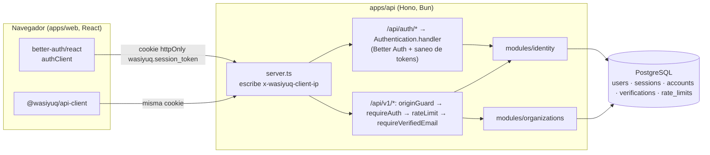

# Arquitectura de autenticación — WASIYUQ 2.0 (Fase 3)

**Fecha:** 2026-11-17  
**Decisión:** ADR-010 (`docs/modernization/TECHNOLOGY_DECISIONS.md`). **Estado:** implementado y verificado (tests de integración + E2E en navegador).

## 1. Visión general

- **Proveedor:** Better Auth `1.7.15` (versión fijada), adaptador Drizzle, PostgreSQL. Telemetría desactivada.
- **Aislamiento del proveedor:** solo `modules/identity/src/infrastructure/authentication.ts` importa Better Auth. El resto ve la interfaz `Authentication` (`handler`, `getSession`) y el tipo de dominio `IdentityUser`.
- **Composición:** `apps/api/src/services.ts` conecta identity ↔ organizations (hook post-registro que crea la organización personal; notificador de invitaciones).

## 2. Capacidades implementadas

| Capacidad | Implementación | Verificación |
|---|---|---|
| Registro email/contraseña | `POST /api/auth/sign-up/email`; contraseña 8–128, hash scrypt en `accounts.password` | tests identity + API + E2E |
| Login / logout | `POST /api/auth/sign-in/email`, `POST /api/auth/sign-out` | ídem |
| Sesiones | Tabla `sessions`, expiración 7 días, renovación diaria (`updateAge`), **sin cookie cache** → revocación inmediata | test de sesión expirada y revocada |
| Listar/revocar sesiones | `GET /api/v1/me/sessions`, `DELETE /api/v1/me/sessions/:id`, `POST /api/v1/me/sessions/revoke-others` (propias del módulo; ver §5) | tests API |
| Verificación de email | Enlace firmado (24 h) enviado al registrarse; `autoSignInAfterVerification`; reenvío desde la UI | tests + E2E |
| Recuperación de contraseña | Token (1 h) almacenado **hasheado**, de un solo uso; al restablecer se **revocan todas las sesiones** | tests + E2E |
| Google OAuth | Activado **solo** si `GOOGLE_CLIENT_ID` y `GOOGLE_CLIENT_SECRET` están definidos; vinculación por email verificado (`trustedProviders: ["google"]`, paridad Socialite) | configuración probada; **no probado contra Google real** |
| Estado de cuenta | `users.status` (`active`/`suspended`): suspendida → no puede iniciar sesión y sus sesiones se invalidan (fail closed) | tests identity + API |
| Rate limiting | Better Auth, almacenamiento en BD (`rate_limits`), compartido entre instancias | test 6.º intento → 429 |
| Diferido | 2FA TOTP y passkeys (ver §7) | — |

### Reglas de rate limiting (por IP de cliente y ruta)

| Ruta | Límite |
|---|---|
| `/sign-in/email` | 5 / 60 s (legacy Fortify: 5/min) |
| `/sign-up/email` | 5 / 60 s |
| `/request-password-reset` | 3 / 300 s |
| `/reset-password` | 5 / 300 s |
| `/send-verification-email` | 3 / 300 s |
| Resto de `/api/auth/*` | 100 / 60 s |
| `/api/v1/*` (por usuario, en memoria) | 120 / 60 s; `/api/v1/invitations/*` 20 / 60 s |

**IP del cliente:** el servidor siempre sobrescribe `x-wasiyuq-client-ip` con la IP del socket o, si `AUTH_TRUST_PROXY=true`, con el salto **más a la derecha** de `X-Forwarded-For` (el que añade nuestro proxy). Un cliente nunca elige la clave de rate limiting.

## 3. Cookies y CSRF

- Cookie `wasiyuq.session_token`: `HttpOnly`, `SameSite=Lax`, `Secure` en producción, firmada con `AUTH_SECRET`.
- La web consume la API en el **mismo origen** (`/api` proxificado por Vite en desarrollo; en producción, un único origen o proxy inverso). No se configura CORS.
- **Saneo de respuestas:** Better Auth incluye el token de sesión en algunos JSON (sign-up, sign-in, get-session). `stripSessionTokens` elimina cualquier clave `token` de los cuerpos JSON de `/api/auth/*`; `/list-sessions` está desactivado.
- **CSRF:** Better Auth valida `Origin` en `/api/auth/*` (forzado también en tests: la librería lo desactiva por defecto cuando detecta entorno de test). `/api/v1/*` aplica `originGuard`: mutaciones con `Origin` no confiable → 403 `INVALID_ORIGIN`; mutaciones con cookie y sin `Origin` → 403.
- Las URL de redirección (`callbackURL`, `redirectTo`) solo se aceptan dentro de `trustedOrigins` (sin open redirect). En la web, `safeRedirect` solo admite rutas relativas del mismo sitio.

## 4. Correo

Puerto `EmailSender` (`modules/identity/src/domain/ports.ts`). Transportes: `console` (desarrollo: imprime el mensaje y su enlace en la salida de la API) y `memory` (tests). **No hay transporte de producción**: la configuración se niega a arrancar con `NODE_ENV=production` hasta implementarlo (decisión pendiente: proveedor SMTP/API).

## 5. Endpoints de Better Auth desactivados

`/update-user`, `/change-email`, `/delete-user`, `/list-sessions`. El perfil se edita con `PATCH /api/v1/me` (validación Zod, reglas legacy de DNI/WhatsApp). Cambio de email y eliminación de cuenta **no están implementados** (decisión pendiente: retención de datos de adopciones/documentos asociados).

## 6. Autenticación móvil (planificada, no implementada)

`apps/mobile` (Expo) no se modificó funcionalmente. Enfoque previsto, compatible con lo implementado:

1. **Plugin oficial `@better-auth/expo`** (misma versión que el servidor) en cliente y servidor: guarda la cookie de sesión en `expo-secure-store` y la envía como cabecera `Cookie`; los flujos OAuth usan deep links (`scheme` de la app añadido a `trustedOrigins`).
2. Las peticiones de la app no llevan `Origin` de navegador. Para no debilitar `originGuard`, se añadirá un mecanismo explícito (p. ej. plugin `bearer` con token en `Authorization`, sin cookie), de modo que la regla "cookie sin Origin → 403" siga protegiendo a los navegadores.
3. El saneo de tokens en JSON se mantendrá para navegadores; el canal móvil obtendrá el token por el mecanismo del plugin, nunca vía JavaScript de una web.
4. La autorización no cambia: `/api/v1/*` resuelve la misma sesión y aplica las mismas políticas por organización.

## 7. Brechas de paridad y decisiones pendientes

| Tema | Estado | Nota |
|---|---|---|
| 2FA TOTP (legacy: Fortify con confirmación) | **Diferido** | Plugin `twoFactor` disponible; requiere UI de alta, códigos de recuperación y desafío en login. No se entrega a medias. |
| Passkeys (legacy: Fortify passkeys) | **Diferido** | Requiere definir RP ID/dominios de producción. |
| Google OAuth | Implementado, sin prueba real | Requiere credenciales y URI de callback `${AUTH_BASE_URL}/api/auth/callback/google`. |
| Transporte de correo en producción | Pendiente | Bloquea despliegue a producción (intencionado). |
| Cambio de email / eliminación de cuenta | No implementado | Definir política de retención. |
| Consulta DNI (apisperu) al registrarse | No implementado | Integración de fase posterior (`modules/integrations`). |
| Rate limiting de `/api/v1` | En memoria por proceso | Suficiente para una instancia; mover a BD/Redis al escalar. |
