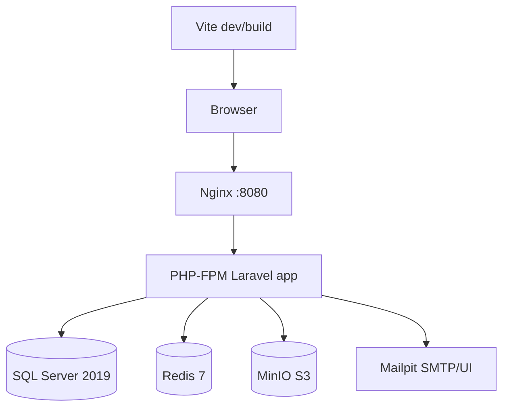

# Arquitectura actual

**Fecha:** 2026-11-16  
**Fuentes:** `bootstrap/app.php`, `routes/*`, `app/*`, `resources/js/*`, `config/*`, `docker-compose.yml`, `vite.config.ts`.

## 1. Estilo arquitectónico

- **Monolito full-stack** basado en Laravel con frontend SPA híbrida mediante **Inertia.js** (Vue 3). No existe una API REST separada como producto principal; la navegación y mutaciones se realizan mayoritariamente por rutas web/controladores Inertia, con endpoints puntuales tipo API (`/api/chatbot/ask`, `/api/dni/lookup`, `/health`).
- **Organización por capas parcialmente explícitas:** Controllers → Services → Repositories → Models/Eloquent en algunos dominios (pets, adoptions, announcements, blog), con lógica adicional en closures de rutas, modelos y componentes frontend.
- **Multi-tenancy lógico por equipos (`Team`)**: segmentación de operaciones organizacionales por slug en ruta (`/{current_team}/...`) y por pertenencia/membresía.

## 2. Backend

### 2.1 Bootstrap y pipeline HTTP
- `bootstrap/app.php` configura routing (admin group, web group), middleware web global (`HandleAppearance`, `HandleInertiaRequests`, `AddLinkHeadersForPreloadedAssets`, `SetTeamUrlDefaults`) y alias `admin` → `IsSuperAdmin`.
- Rutas divididas por contexto: `public.php`, `web.php` (incluye adoptante, equipos, APIs internas, settings), `admin.php`.

### 2.2 Componentes principales (`app/`)
| Capa/elemento | Rol | Ejemplos |
|---|---|---|
| Controllers | Orquestación HTTP/Inertia, validación implícita/requests, respuestas | `Public/*`, `Adopter/*`, `Teams/*`, `Dashboard/*`, `Admin/*`, `Settings/*`, `Api/DniController` |
| Requests | Form Requests para validación (inventario presente) | `app/Http/Requests/**` (detalle por auditar) |
| Services | Lógica de negocio/orquestación transaccional | `AdoptionService`, `PetService`, `FollowUpService`, `DniLookupService`, `ChatbotService` |
| Repositories | Acceso a datos/consultas | `PetRepository`, `AdoptionRepository`, `AnnouncementRepository`, `BlogPostRepository` |
| Models | Eloquent, relaciones, casts, soft deletes, slugs | `User`, `Team`, `Pet`, `Adoption`, `FollowUp`, etc. |
| Enums | Estados, tipos, roles y permisos | `PetStatus`, `AdoptionStatus`, `TeamRole`, `TeamPermission` |
| Policies/Middleware | Autorización y contexto | `TeamPolicy`, `IsSuperAdmin`, `EnsureTeamMembership` |
| Events/Listeners/Jobs/Notifications/Mail | Side-effects y procesos asíncronos | adopciones, actas/certificados, seguimientos, notificaciones, correo contacto |

### 2.3 Patrones observados
- **Transacciones** en operaciones críticas (p.ej. creación/aprobación/rechazo/cancelación de adopciones con cambio de estado de mascota).
- **Eventos de dominio Laravel** para adopción (`Submitted/Approved/Completed`).
- **Stored procedures T-SQL** disponibles para búsquedas/detalles (pets/adoptions/announcements/blog); integración real con ejecución en runtime a confirmar.
- **Slugs** como identificadores públicos (`Pet`, `Team`, `Announcement`, `BlogPost`).

## 3. Frontend

### 3.1 Stack y composición
- **Vue 3 + TypeScript** con Inertia 3, Vite 8, Tailwind CSS 4 (CSS-first tokens), componentes estilo shadcn/reka-ui.
- **Entry:** `resources/js/app.ts` inicializa tema, toasts de flash, Capacitor hooks y resuelve layout por prefijo de página (`Public/*`, `auth/*`, áreas dashboard/admin/adopter/teams/settings).
- **Wayfinder:** generación de helpers tipados de rutas/acciones (`resources/js/routes/**`, `resources/js/actions/**`) consumidos en UI.
- **Estado:** principalmente Inertia props/forms + composables; `stores/` sin módulos activos detectados.

### 3.2 Organización UI
- Páginas por dominio (`pages/Public`, `pages/Adopter`, `pages/Dashboard`, `pages/Admin`, `pages/settings`, `pages/Teams|teams`, `pages/auth`).
- Layouts diferenciados (público, auth split, dashboard con navegación contextual por rol/equipo).
- Componentes UI reutilizables y específicos (chatbot, charts, pets).

## 4. Datos e integraciones

- **BD principal prevista:** SQL Server 2019 (`sqlsrv`), con migraciones Laravel y artefactos SP T-SQL.
- **Almacenamiento:** local por defecto; MinIO/S3 disponible en entorno compose.
- **Correo:** Mailpit en dev; config mail Laravel.
- **Externos:** Google OAuth, API DNI (apisperu), GA4 (configurado).
- **Tiempo real/colas:** infraestructura Redis disponible; configuración ejemplo usa `sync/file` (efectivo por entorno).

## 5. Despliegue y ejecución (entorno de desarrollo)

- Docker Compose orquesta servicios; Dockerfile PHP instala drivers `sqlsrv/pdo_sqlsrv`, extensiones y Node 20.
- Capacitor empaqueta cliente web para Android/iOS (config de dev server embebida en `capacitor.config.ts`).

## 6. Fortalezas observadas

- Dominio relativamente rico y cubierto (adopción end-to-end + contenido + comunidad).
- Uso de enums, servicios, repositorios y eventos en áreas clave.
- Tipado frontend y helpers de rutas generados.
- Infra de desarrollo reproducible (compose, make targets).

## 7. Problemas arquitectónicos y deuda (resumen)

| Área | Hallazgo | Evidencia | Impacto |
|---|---|---|---|
| Consistencia de arquitectura | Mezcla de Service/Repository con lógica en closures de rutas y consultas directas en controladores/rutas | `routes/web.php` dashboard team; servicios + repos parciales | Mantenibilidad y testabilidad desiguales |
| Autorización | Permisos granulares definidos pero enforcement por acción no totalmente evidenciado; hardcode de superadmin por email | `TeamPermission`, middlewares | Riesgo de seguridad y dificultad de auditoría |
| Persistencia híbrida | Migraciones Laravel + SPs T-SQL con posible desfase; uso real de SPs no confirmado | `database/stored-procedures`, repos | Complejidad operativa y migración |
| Configuración | Discrepancias README vs versiones/config reales; defaults `sync/file` vs servicios disponibles | README, `.env.example`, compose | Ambigüedad de entorno real |
| Frontend | Múltiples layouts/páginas legacy (`Welcome`) y configuración de dev en Capacitor | `pages/Welcome.vue`, `capacitor.config.ts` | Confusión y riesgo de empaquetado |
| Acoplamiento a framework | Lógica de negocio y presentación acopladas al ecosistema Laravel/Inertia | estructura general | Costo de migración (justifica reconstrucción planificada) |

## 8. Implicaciones para modernización

- Extraer **dominio y reglas** (estados, transiciones, permisos, validaciones) como fuente de verdad independiente de framework.
- Diseñar **contratos API tipados** y módulos por bounded context antes de reimplementar UI.
- Planificar migración de datos **SQL Server → PostgreSQL** y sustitución/retirada de SPs por consultas/servicios equivalentes verificables.
- Consolidar autenticación/autorización y eliminar excepciones hardcodeadas.
