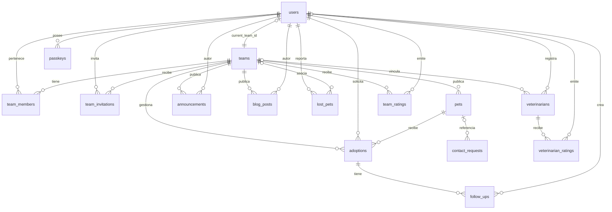

# Esquema de base de datos (estado actual)

**Fecha:** 2026-11-16  
**Fuentes:** `database/migrations/*.php` (26 archivos + `migrations/stored_procedures/.gitkeep`), `database/stored-procedures/**/*.sql` (9), `app/Models/*`, auditoría estática.  
**Motor previsto en entorno:** SQL Server (`sqlsrv`, ver `docker-compose.yml`, `.env.example`, `config/database.php`). Las migraciones usan API Laravel/Blueprint; los procedimientos almacenados están en **T-SQL** (`[dbo]`, `NVARCHAR`, `OFFSET/FETCH`, etc.).

> **Nota:** No se ejecutaron migraciones ni se inspeccionó una BD en ejecución; el esquema se documenta a partir de definiciones en código.

## 1. Inventario de migraciones

| # | Archivo | Acción principal | Tablas |
|---|---|---|---|
| 1 | `0001_01_01_000000_create_users_table.php` | create | `users`, `password_reset_tokens`, `sessions` |
| 2 | `0001_01_01_000001_create_cache_table.php` | create | `cache`, `cache_locks` |
| 3 | `0001_01_01_000002_create_jobs_table.php` | create | `jobs`, `job_batches`, `failed_jobs` |
| 4 | `2024_01_01_000000_create_passkeys_table.php` | create | `passkeys` |
| 5 | `2025_08_14_170933_add_two_factor_columns_to_users_table.php` | alter | `users` (2FA) |
| 6 | `2026_01_27_000001_create_teams_table.php` | create | `teams`, `team_members`, `team_invitations` |
| 7 | `2026_01_27_000002_add_current_team_id_to_users_table.php` | alter | `users.current_team_id` |
| 8 | `2026_01_28_000001_add_organization_fields_to_teams_table.php` | alter | `teams` (perfil org) |
| 9 | `2026_01_28_000002_create_pets_table.php` | create | `pets` |
| 10 | `2026_01_28_000003_create_announcements_table.php` | create | `announcements` |
| 11 | `2026_01_28_000004_create_blog_posts_table.php` | create | `blog_posts` |
| 12 | `2026_01_28_000005_create_adoptions_table.php` | create | `adoptions` |
| 13 | `2026_01_28_000006_create_follow_ups_table.php` | create | `follow_ups` |
| 14 | `2026_01_29_000001_add_is_super_admin_to_users_table.php` | alter | `users.is_super_admin` |
| 15 | `2026_05_26_122303_increase_cover_image_length.php` | alter | `announcements.cover_image`, `blog_posts.cover_image` → text |
| 16 | `2026_05_26_124025_add_social_fields_to_users_table.php` | alter | `users` (social_id/provider/avatar) |
| 17 | `2026_05_26_140346_create_contact_requests_table.php` | create | `contact_requests` |
| 18 | `2026_05_28_040020_add_acta_path_to_adoptions_table.php` | alter | `adoptions.acta_path` |
| 19 | `2026_06_09_000001_add_tracking_fields_to_follow_ups_table.php` | alter | `follow_ups` (drive_link, weight_kg, vaccines, behavior, health_status) |
| 20 | `2026_06_09_000002_add_screening_fields_to_adoptions_table.php` | alter | `adoptions` (screening) |
| 21 | `2026_06_29_000001_create_lost_pets_table.php` | create | `lost_pets` |
| 22 | `2026_06_29_000002_add_whatsapp_to_users_table.php` | alter | `users.whatsapp` |
| 23 | `2026_06_29_000003_add_dni_to_users_table.php` | alter | `users.dni` unique |
| 24 | `2026_07_03_000001_create_veterinarians_table.php` | create | `veterinarians`, `veterinarian_ratings` |
| 25 | `2026_07_04_000001_create_team_ratings_table.php` | create | `team_ratings` |
| 26 | `2026_07_04_000002_add_profile_fields_to_teams.php` | alter | `teams` (map_embed, gallery, support_info) |

## 2. Tablas de dominio y aplicación

### 2.1 Identidad y acceso
| Tabla | Propósito | Columnas clave | Restricciones/índices destacados |
|---|---|---|---|
| `users` | Usuarios de la plataforma | `id`, `name`, `email`, `dni`, `whatsapp`, `password`, `is_super_admin`, `current_team_id`, `social_id/provider`, `avatar`, 2FA, timestamps | `email` unique, `dni` unique (nullable), FK `current_team_id→teams` nullOnDelete |
| `password_reset_tokens` | Tokens de reset | `email` PK, `token`, `created_at` | PK email |
| `sessions` | Sesiones | `id` PK, `user_id` idx nullable, `ip_address`, `user_agent`, `payload`, `last_activity` idx | Sin FK explícita a users en migración |
| `passkeys` | Passkeys/WebAuthn | `user_id` FK cascade, `credential_id` unique, `credential` json, `last_used_at` | FK cascade, unique credential_id |

### 2.2 Equipos y membresías
| Tabla | Propósito | Columnas clave | Restricciones |
|---|---|---|---|
| `teams` | Organizaciones/albergues y equipos personales | `name`, `slug` unique, `is_personal`, perfil (bio, logo, contacto, ubicación, `social_links`, `map_embed`, `gallery`, `support_info`), softDeletes | slug unique |
| `team_members` | Membresía usuario-equipo | `team_id`, `user_id`, `role`, timestamps | unique (`team_id`,`user_id`), FKs cascade |
| `team_invitations` | Invitaciones | `code` unique, `team_id`, `email`, `role`, `invited_by`, `expires_at`, `accepted_at` | FKs cascade |
| `team_ratings` | Calificación de albergues/equipos | `team_id`, `user_id`, `rating`, `comment` | unique (`team_id`,`user_id`) |

### 2.3 Mascotas y adopciones
| Tabla | Propósito | Columnas clave | Restricciones |
|---|---|---|---|
| `pets` | Mascotas gestionadas por equipo | `team_id`, `name`, `slug` unique, `species`, `breed`, edad, `gender`, `size`, `color`, `description`, `medical_notes`, `status` default `available`, `photos` json, softDeletes | FK team cascade, slug unique |
| `adoptions` | Solicitudes/procesos de adopción | `pet_id`, `user_id` (adoptante), `team_id`, `status`, motivación/screening (vivienda, experiencia, niños, otras mascotas, horas solo, plan veterinario, acuerdo), `notes`, `reviewed_by/at`, `acta_path`, softDeletes | `user_id` cascade; `pet_id/team_id/reviewed_by` noActionOnDelete |
| `follow_ups` | Seguimientos post-adopción | `adoption_id`, fechas programada/completada, `status`, `notes`, `photos`, `created_by`, tracking (`drive_link`, `weight_kg`, `vaccines`, `behavior`, `health_status`) | `adoption_id` cascade; `created_by` noActionOnDelete; sin softDeletes |

### 2.4 Contenido y comunidad
| Tabla | Propósito | Columnas clave | Restricciones |
|---|---|---|---|
| `announcements` | Eventos/anuncios/campañas | `team_id`, `user_id`, `title`, `slug`, `description`, `event_date`, `location`, `type`, `cover_image` (text), `is_published`, `published_at`, softDeletes | slug unique, FKs cascade |
| `blog_posts` | Publicaciones de blog | `team_id`, `user_id`, `title`, `slug`, `excerpt`, `content`, `cover_image` (text), `category`, `tags` json, publicación, softDeletes | slug unique, FKs cascade |
| `lost_pets` | Mascotas perdidas/encontradas reportadas | especie, datos descriptivos, última ubicación/fecha, contacto, `photos`, `status`, `is_resolved`, `user_id/team_id` opcionales, softDeletes | FKs nullOnDelete |
| `contact_requests` | Mensajes de contacto | `name`, `email`, `subject`, `message`, `pet_id` opcional, `read_at` | `pet_id` nullOnDelete |

### 2.5 Directorio veterinario
| Tabla | Propósito | Columnas clave | Restricciones |
|---|---|---|---|
| `veterinarians` | Directorio de veterinarias | nombre, dirección/ciudad, contacto, web, geo, descripción, `services/photos` json, `is_verified`, `team_id/user_id` opcionales, softDeletes | FKs nullOnDelete |
| `veterinarian_ratings` | Calificaciones | `veterinarian_id`, `user_id`, `rating`, `comment` | unique (`veterinarian_id`,`user_id`) |

### 2.6 Infraestructura Laravel
`cache`, `cache_locks`, `jobs`, `job_batches`, `failed_jobs` (esquema estándar Laravel).

## 3. Diagrama ER (Mermaid, simplificado)

## 4. Stored procedures (artefactos T-SQL)

**Ubicación:** `database/stored-procedures/{adoptions,announcements,blog,pets,reports}/` (9 `.sql`, `reports/` vacío).  
**Comando de carga:** `php artisan app:load-stored-procedures` / `make sp` (referenciado en scripts).

| Procedimiento | Parámetros | Propósito | Tablas |
|---|---|---|---|
| `[dbo].[sp_get_adoption_detail]` | `@adoption_id` | Detalle de adopción con mascota, adoptante, revisor, equipo | `adoptions,pets,users,teams` |
| `[dbo].[sp_list_organization_adoptions]` | `@team_id`, `@status` | Listado por organización | `adoptions,pets,users` |
| `[dbo].[sp_get_announcement_detail]` | `@slug` | Detalle de anuncio publicado | `announcements,teams,users` |
| `[dbo].[sp_search_announcements]` | `@type,@team_id,@page,@per_page` | Búsqueda paginada publicada | `announcements,teams,users` |
| `[dbo].[sp_get_blog_post_detail]` | `@slug` | Detalle de post | `blog_posts,teams,users` |
| `[dbo].[sp_search_blog_posts]` | `@category,@team_id,@page,@per_page` | Búsqueda paginada publicada | `blog_posts,teams,users` |
| `[dbo].[sp_get_organization_pets]` | `@team_id`, `@status` | Mascotas por organización | `pets` |
| `[dbo].[sp_get_pet_detail]` | `@slug` | Detalle mascota + equipo | `pets,teams` |
| `[dbo].[sp_search_pets]` | `@species,@size,@gender,@status,@search,@page,@per_page` | Búsqueda paginada con filtro LIKE nombre/raza | `pets,teams` |

**Hallazgos:**
- Los SPs no seleccionan columnas añadidas posteriormente (p.ej. screening/acta en adopciones, tracking en seguimientos, campos de perfil extendido de teams). Posible desfase entre SPs y esquema actual.
- Uso real desde aplicación (Repositories/`DB::select`/`exec`) **pendiente de verificación exhaustiva**; los repositorios inspeccionados (`PetRepository`, `AdoptionRepository`, etc.) deben mapearse contra estas rutinas.

## 5. Observaciones e inconsistencias potenciales

1. **Borrado lógico vs integridad:** varias FKs de `adoptions` usan `noActionOnDelete` mientras `pets/teams/users` pueden tener soft delete o borrado; requiere cuidado en consultas y migración de datos.
2. **`sessions.user_id`:** indexado sin FK declarada.
3. **Desfase SP-esquema/factories:** SPs y algunas factories no cubren campos nuevos (screening, tracking, acta).
4. **Tablas sin SP dedicado:** `contact_requests`, `lost_pets`, `veterinarians*`, `team_ratings`, `follow_ups`, etc. se gestionan por Eloquent según evidencia parcial.
5. **Semántica de estados/tipos:** almacenados como strings en BD; enums PHP definen valores canónicos (`PetStatus`, `AdoptionStatus`, `FollowUpStatus`, `AnnouncementType`, `PetSize`, `PetSpecies`).
